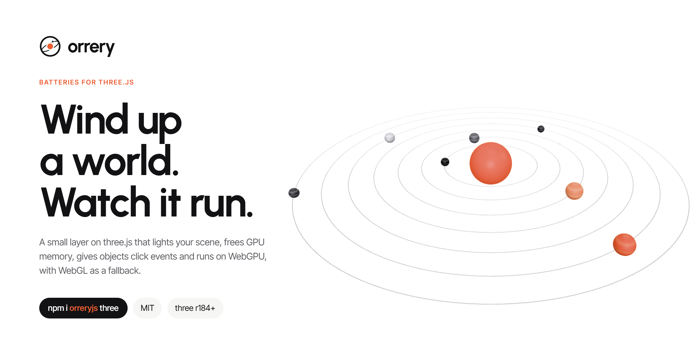
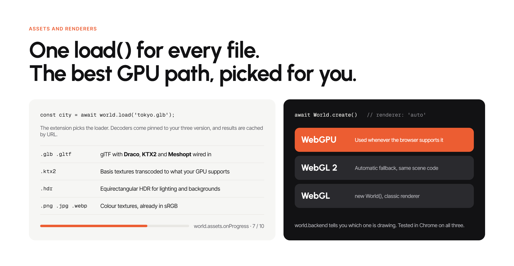

<p align="center"></p>

<p align="center">
  <a href="https://mrigankad.github.io/Orrery/"><b>Live demo</b></a> ·
  <a href="#quick-start">Quick start</a> ·
  <a href="#api">API</a> ·
  <a href="#roadmap">Roadmap</a>
</p>

<p align="center"></p>

<p align="center"></p>

## Quick start

```sh
npm i orreryjs three
```

```js
import { BoxGeometry, Mesh, MeshStandardMaterial } from 'three';
import { World } from 'orreryjs';

const world = await World.create( { container: document.querySelector( '#app' ) } );

const cube = new Mesh( new BoxGeometry(), new MeshStandardMaterial( { color: 0xff4f1a } ) );
world.add( cube );

world.on( cube, 'click', () => world.remove( cube ) ); // detaches and frees GPU memory
world.onUpdate( ( dt ) => { cube.rotation.y += dt; } );
world.start();

const city = await world.load( 'city.glb' ); // Draco, KTX2 and Meshopt ready
world.add( city.scene );
```

If you use three's WebGPU build through an import map, also map `three/webgpu`. The [demo](examples/index.html) shows a working import map.

## API

| | |
| --- | --- |
| `await World.create(config)` | WebGPU by default, WebGL 2 fallback built in. `renderer: 'auto' \| 'webgl2' \| 'webgl'` |
| `new World(config)` | Same World on the classic WebGL renderer, created synchronously |
| `world.backend` | `'webgpu'`, `'webgl2'` or `'webgl'` |
| `world.add(...objects)` / `world.remove(obj)` | `remove` detaches and disposes geometry, materials and textures |
| `world.on(obj, type, fn)` | `click`, `pointerenter`, `pointerleave`, `pointerdown`, `pointerup`; returns an unsubscribe |
| `world.load(url)` | glTF/GLB, KTX2, HDR, PNG/JPG/WebP. Cached by URL |
| `world.assets.onProgress(fn)` | `{ url, loaded, total, done }` across every load |
| `world.optimize(root?)` | Folds meshes sharing geometry and material into InstancedMeshes (300 rocks: 300 draw calls to 1). Meshes with events are kept |
| `adaptive: true` | Lowers resolution when frames run over budget, raises it back with headroom. `world.resolutionScale` |
| `world.onGpuLost(fn)` | WebGPU device loss or WebGL context loss, reported once as `{ api, reason, message }` |
| `world.onUpdate(fn)` / `start()` / `stop()` / `dispose()` | Frame loop and lifecycle |
| Config | `lights: 'studio' \| 'none'`, `environment: 'room' \| 'none'`, `toneMapping`, `warnings`, `fov`, `near`, `far` |

Also exported: `createAssetLoader`, `addOrbitControls`, `loadGLTF`, `loadTexture`, `setEnvironment`, `memoizeLoader`, `screenshot`, `addStats`, `addPicking`, `loadAudio`, `disposeObject`, `Loop`, `ResizeManager`, `SceneApp`. Types ship in `index.d.ts`.

## Devtools

```js
import { mountDevtools } from '@orreryjs/devtools';
mountDevtools( world );   // ` toggles, Alt+click selects in the scene
```

A frame graph with a budget line, draw call and triangle budgets, GPU memory with a leak check (geometries that left the scene without `dispose()`), a live scene tree and an inspector. Try it on the [demo](https://mrigankad.github.io/Orrery/examples/?devtools).

## Physics

```js
import { addPhysics } from '@orreryjs/physics';

const physics = await addPhysics( world );        // Rapier, loaded on first use
physics.add( floor, { type: 'fixed' } );          // collider from the mesh's geometry
physics.add( crate );                            // dynamic box
physics.onCollision( crate, ( other, started ) => started && console.log( other.name ) );
world.on( crate, 'click', () => physics.applyImpulse( crate, [ 0, 6, 0 ] ) );
world.remove( crate );                           // the body goes with it
```

Fixed-step simulation inside the world loop, automatic shapes (ball, cuboid, capsule, convex hull, or exact triangles for static meshes), nested parents handled, raycasts and teleports. Try the [physics demo](https://mrigankad.github.io/Orrery/examples/physics.html).

## Labels, keyboard access and text

```js
import { createUI } from '@orreryjs/ui';

const ui = createUI( world );
ui.pin( planet, 'Juno', { fade: { near: 14, far: 30 }, occlude: true } ); // HTML chip that follows it
ui.pin( sun, cardElement, { anchor: 'right' } );                         // any HTML
ui.accessible( planet, 'Juno' );          // Tab reaches it, Enter fires world.on( planet, 'click' )
world.add( ui.text( 'orrery' ) );         // text as a mesh, WebGPU and WebGL
```

Labels are real DOM: sharp at any zoom, readable by screen readers, sorted by depth, dimmed when something is in front. On the [demo](https://mrigankad.github.io/Orrery/), press Tab to move through the planets.

## Roadmap

<p align="center"></p>

## Develop

```sh
npm install
npm run dev        # demo on http://127.0.0.1:5173  (?renderer=webgl2 or ?renderer=webgl)
npm test           # node --test, 47 tests across four packages (physics runs real Rapier)
npm run typecheck
```

A test checks that every `three/addons` file Orrery imports still exists in the installed three, so an upstream rename fails CI instead of failing users.

## Credit

Orrery is an independent project built on [three.js](https://github.com/mrdoob/three.js). It is not affiliated with or endorsed by the three.js project. All credit for three.js goes to [mrdoob](https://github.com/mrdoob) and its contributors. MIT licensed.
