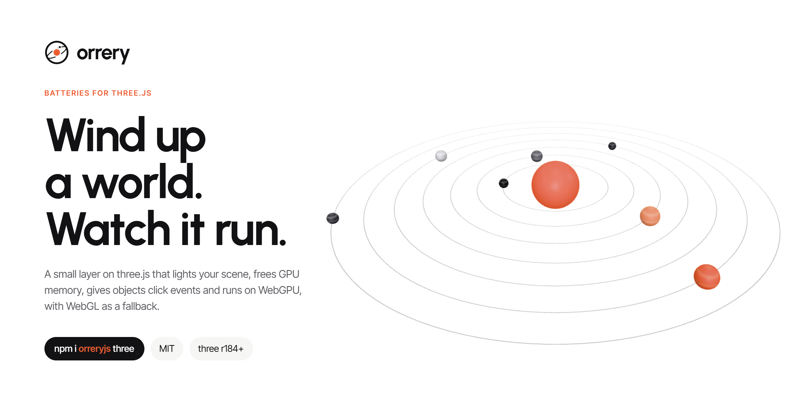
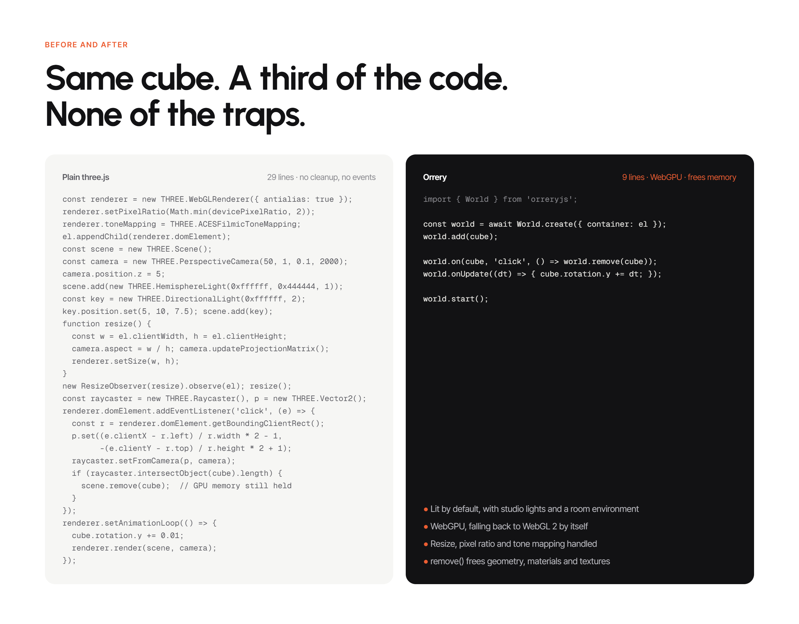
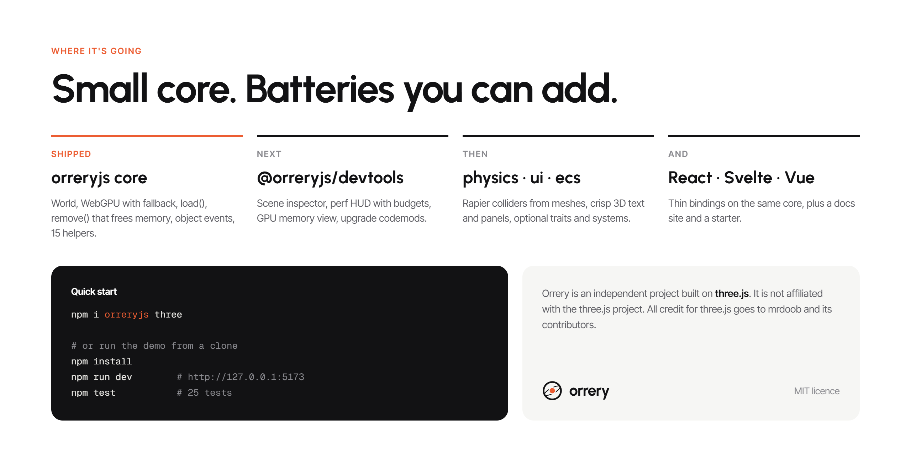

<p align="center"></p>

<p align="center">
  <a href="https://mrigankad.github.io/Orrery/"><b>Live demo</b></a> ·
  <a href="#quick-start">Quick start</a> ·
  <a href="#api">API</a> ·
  <a href="#roadmap">Roadmap</a>
</p>

<p align="center"></p>

<p align="center"></p>

## Quick start

```sh
npm i orreryjs three
```

```js
import { BoxGeometry, Mesh, MeshStandardMaterial } from 'three';
import { World } from 'orreryjs';

const world = await World.create( { container: document.querySelector( '#app' ) } );

const cube = new Mesh( new BoxGeometry(), new MeshStandardMaterial( { color: 0xff4f1a } ) );
world.add( cube );

world.on( cube, 'click', () => world.remove( cube ) ); // detaches and frees GPU memory
world.onUpdate( ( dt ) => { cube.rotation.y += dt; } );
world.start();

const city = await world.load( 'city.glb' ); // Draco, KTX2 and Meshopt ready
world.add( city.scene );
```

If you use three's WebGPU build through an import map, also map `three/webgpu`. The [demo](https://github.com/mrigankad/Orrery/blob/main/examples/index.html) shows a working import map.

## API

| | |
| --- | --- |
| `await World.create(config)` | WebGPU by default, WebGL 2 fallback built in. `renderer: 'auto' \| 'webgl2' \| 'webgl'` |
| `new World(config)` | Same World on the classic WebGL renderer, created synchronously |
| `world.backend` | `'webgpu'`, `'webgl2'` or `'webgl'` |
| `world.add(...objects)` / `world.remove(obj)` | `remove` detaches and disposes geometry, materials and textures |
| `world.on(obj, type, fn)` | `click`, `pointerenter`, `pointerleave`, `pointerdown`, `pointerup`; returns an unsubscribe |
| `world.load(url)` | glTF/GLB, KTX2, HDR, PNG/JPG/WebP. Cached by URL |
| `world.assets.onProgress(fn)` | `{ url, loaded, total, done }` across every load |
| `world.onUpdate(fn)` / `start()` / `stop()` / `dispose()` | Frame loop and lifecycle |
| Config | `lights: 'studio' \| 'none'`, `environment: 'room' \| 'none'`, `toneMapping`, `warnings`, `fov`, `near`, `far` |

Also exported: `createAssetLoader`, `addOrbitControls`, `loadGLTF`, `loadTexture`, `setEnvironment`, `memoizeLoader`, `screenshot`, `addStats`, `addPicking`, `loadAudio`, `disposeObject`, `Loop`, `ResizeManager`, `SceneApp`. Types ship in `index.d.ts`.

## Roadmap

<p align="center"></p>

## Develop

```sh
npm install
npm run dev        # demo on http://127.0.0.1:5173  (?renderer=webgl2 or ?renderer=webgl)
npm test           # node --test, 25 tests
npm run typecheck
```

A test checks that every `three/addons` file Orrery imports still exists in the installed three, so an upstream rename fails CI instead of failing users.

## Credit

Orrery is an independent project built on [three.js](https://github.com/mrdoob/three.js). It is not affiliated with or endorsed by the three.js project. All credit for three.js goes to [mrdoob](https://github.com/mrdoob) and its contributors. MIT licensed.
